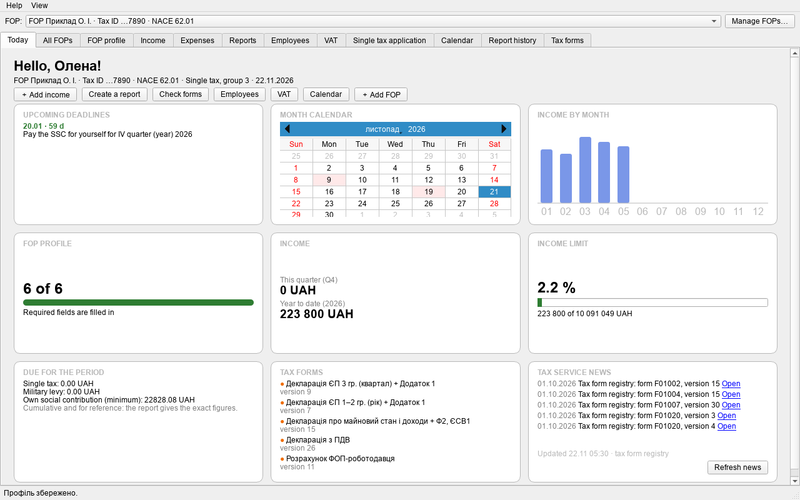
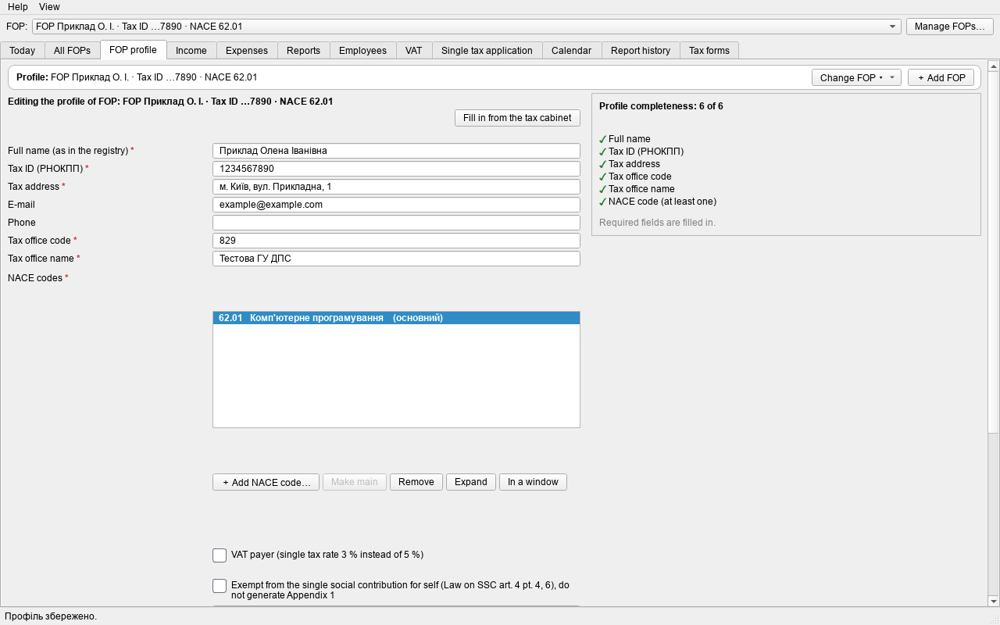
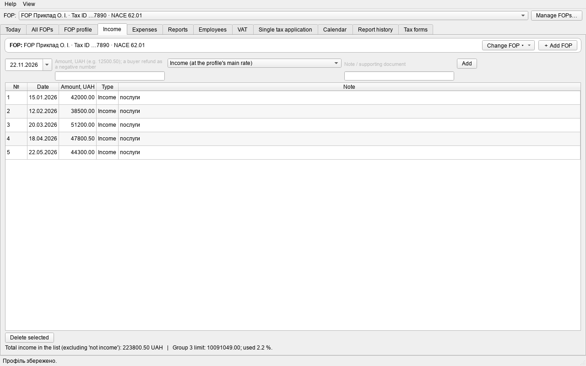
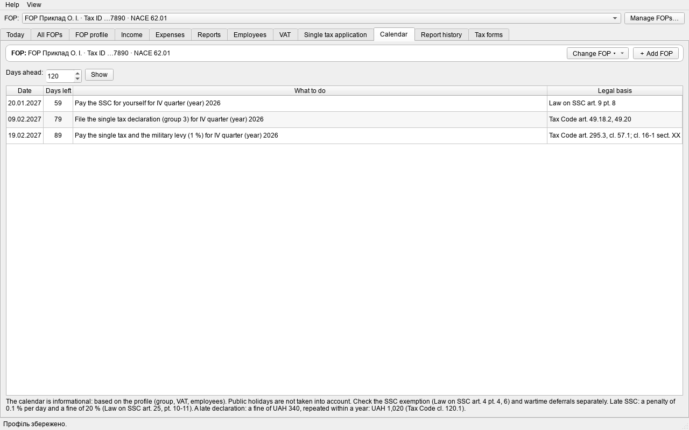

[English](README.md) · [Русский](README.ru.md) · [Українська](README.uk.md)

🌐 All our programs: https://drugoj00.github.io/ · Telegram channel: https://t.me/FOP_helper

# FOP Helper

A Windows program for Ukrainian sole proprietors (FOP): it counts deadlines and taxes by your profile, keeps the income and expense journal, reminds you what to file and pay, and prepares tax reports in the current DPS (tax service) form formats. Everything runs on your computer; the program signs and submits nothing.

⭐ If the program is useful, please star this repository: it costs nothing and helps other people find it.

## Download

**Version 1.0.** [FOP-helper-1.0.exe](https://github.com/drugoj00/fop-helper/releases/download/v1.0/FOP-helper-1.0.exe) · [Releases](https://github.com/drugoj00/fop-helper/releases)

SHA-256: `8da1a6a500f9f023c7d2f48cbc61e5a96bdd3f84b4db00b8ed5f013d394b37bc`

The installer is not yet signed with a publisher certificate: Windows may show a SmartScreen warning ("Unknown publisher"). Press "More info", then "Run anyway". Administrator rights are not needed to install.

## What's new in 1.0

- First public release
- Profile of the sole proprietor (single tax group 1–3 or the general system, VAT payer, employees), several FOPs in one program
- Income and expense journal, control of the single-tax income limit with warnings at 80% and 95%
- Reports: single tax declarations (annual for groups 1–2, quarterly for group 3) with the SSC appendix, general system, employer package, VAT calculation; XML is checked against the official schema before saving
- The form version is compared with the DPS form registry before each report; an outdated or unchecked form is marked and needs confirmation
- Calendar of deadlines by your profile and a reminder of the nearest dates when the program starts
- Optional "Fill from the DPS cabinet": reads your profile after you sign in with your key
- Interface and notifications in Ukrainian, Russian and English, light and dark themes; the documents the program prepares are in Ukrainian only

## Screenshots

(The data in the screenshots is made up.)

## Requirements and limits

- Windows 10 (1809 or newer) or Windows 11, 64-bit; not from the Microsoft Store
- Internet is needed to compare forms with the DPS registry; updating the forms needs Google Chrome and 7-Zip installed
- The program only prepares files: signing with a qualified electronic signature and filing are done by hand in the DPS electronic cabinet. Check every report before filing; the program is not tax advice
- Documents prepared by the program, report row captions and application fields are in Ukrainian only
- Not verified yet: legal wording of the hints for every group and case, installation on all Windows editions

## Support the project

The program is free. If it is useful you can support its development by card, Google Pay or USDT. For USDT use only the TRON network (TRC20): coins sent over another network are lost.

- By card or Google Pay (from 50 UAH): https://secure.wayforpay.com/button/bba92579a4647
- USDT (TRON TRC20): `TXk32CLkwJryTqhmkw6urcM5CacJgPsSpJ`

The source code is not published.
