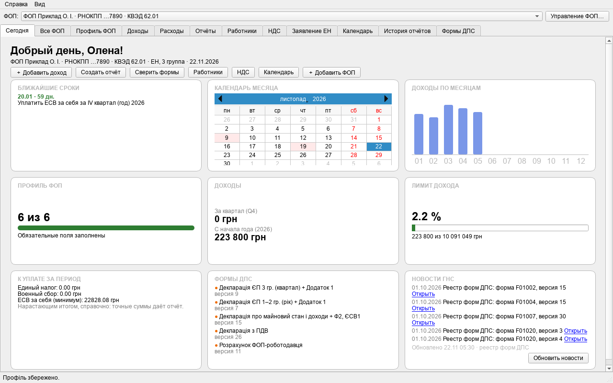
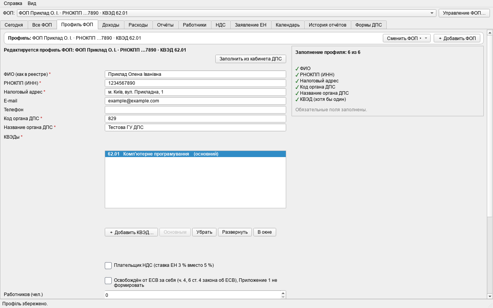
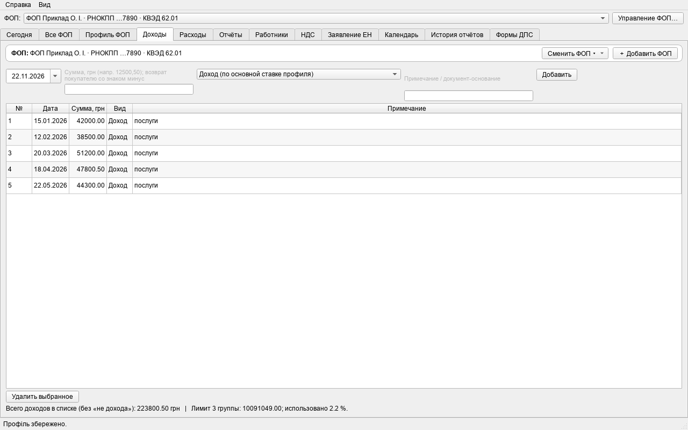
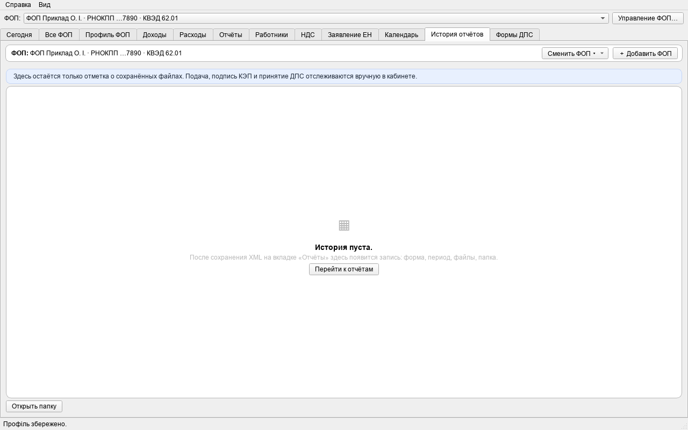

[English](README.md) · [Русский](README.ru.md) · [Українська](README.uk.md)

🌐 Все наши программы: https://drugoj00.github.io/ · Telegram-канал: https://t.me/FOP_helper · Ещё программы автора (Telegram): https://t.me/PhoneInWindowSound

# FOP Helper

Программа для Windows для украинских ФОП, которая сама заполняет налоговые отчёты. Она берёт данные из журнала доходов и расходов и профиля, работает с электронным кабинетом ДПС (входит по вашему ключу и читает реквизиты, КВЭД и актуальные формы), считает сроки и налоги и перед сохранением проверяет каждый отчёт в актуальном формате формы ДПС. Вам остаётся загрузить готовый файл в кабинет и подписать его там. Всё работает на вашем компьютере; программа ничего не подписывает и не отправляет.

⭐ Если программа пригодилась, поставьте звезду этому репозиторию: это бесплатно и помогает другим людям её найти.

## Скачать

**Версия 1.0.** [FOP-helper-1.0.exe](https://github.com/drugoj00/fop-helper/releases/download/v1.0/FOP-helper-1.0.exe) · [Релизы](https://github.com/drugoj00/fop-helper/releases)

SHA-256: `8da1a6a500f9f023c7d2f48cbc61e5a96bdd3f84b4db00b8ed5f013d394b37bc`

Установщик пока не подписан сертификатом издателя: Windows может показать предупреждение SmartScreen («Неизвестный издатель»). Нажмите «Подробнее», затем «Выполнить в любом случае». Права администратора для установки не нужны.

## Что нового в 1.0

- Первый публичный выпуск
- Профиль предпринимателя (единый налог 1-3 групп или общая система, плательщик НДС, работники), несколько ФОП в одной программе
- Журнал доходов и расходов, контроль лимита дохода единого налога с предупреждениями при 80% и 95%
- Отчёты: декларации единого налога (годовая для 1-2 групп, квартальная для 3 группы) с приложением по ЕСВ, общая система, пакет работодателя, расчёт НДС; XML перед сохранением проверяется по официальной схеме
- Версия формы сверяется с реестром форм ДПС перед каждым отчётом; устаревшая или не сверенная форма помечается и требует подтверждения
- Календарь сроков по профилю и напоминание о ближайших датах при запуске программы
- Работает с электронным кабинетом ДПС: входит по вашему ключу (пароль только в памяти) и читает реквизиты, КВЭД и версии форм; по желанию «Заполнить из кабинета ДПС» сама заполняет профиль
- Интерфейс и уведомления на украинском, русском и английском, светлая и тёмная темы; документы, которые формирует программа, только на украинском

## Скриншоты

(Данные на скриншотах выдуманные.)

## Требования и ограничения

- Windows 10 (1809 и новее) или Windows 11, 64-бит; не из Microsoft Store
- Интернет нужен для сверки форм с реестром ДПС; для обновления форм должны быть установлены Google Chrome и 7-Zip
- Программа только готовит файлы: подпись квалифицированной электронной подписью и подача выполняются вручную в электронном кабинете ДПС. Проверяйте каждый отчёт перед подачей; программа не заменяет налоговую консультацию
- Документы, которые формирует программа, подписи строк отчётности и поля заявлений только на украинском
- Пока не проверено: юридические формулировки подсказок по каждой группе и случаю, установка на всех редакциях Windows

## Поддержать проект

Программа бесплатная. Если она вам полезна, можно поддержать разработку банковской картой, Google Pay или USDT. Для USDT только сеть TRON (TRC20): монеты, отправленные по другой сети, будут потеряны.

- Картой или Google Pay (от 50 грн): https://secure.wayforpay.com/button/bba92579a4647
- USDT (TRON TRC20): `TXk32CLkwJryTqhmkw6urcM5CacJgPsSpJ`

Исходный код не публикуется.
