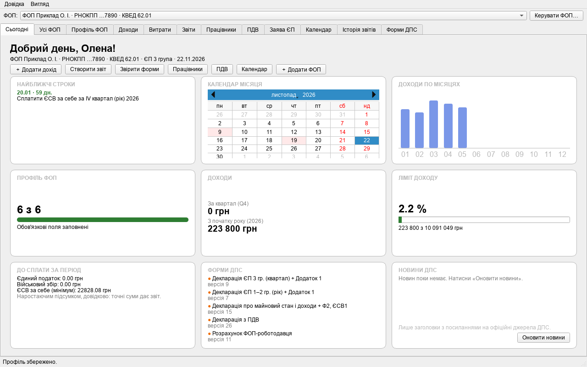
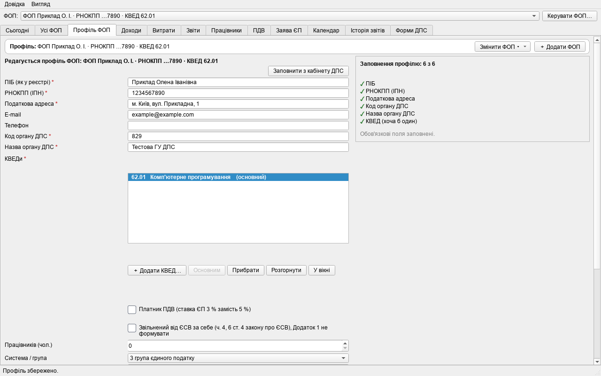
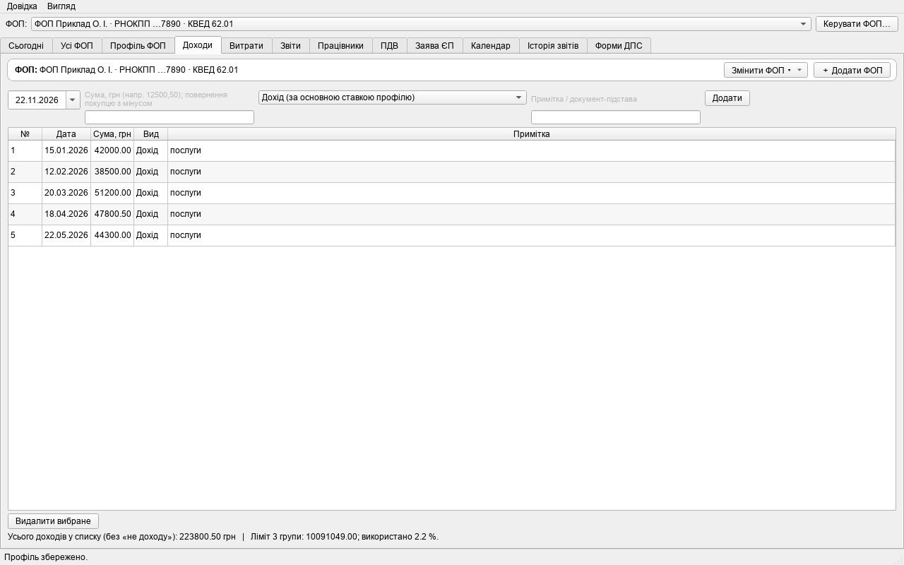
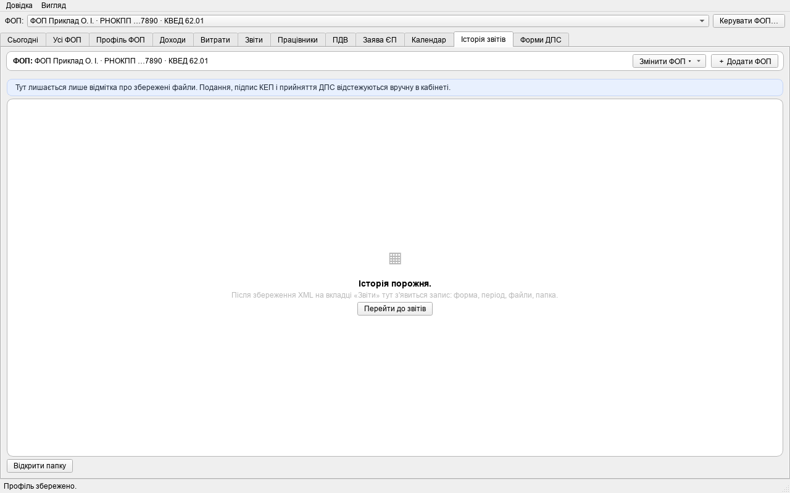

[English](README.md) · [Русский](README.ru.md) · [Українська](README.uk.md)

🌐 Усі наші програми: https://drugoj00.github.io/ · Telegram-канал: https://t.me/FOP_helper

# FOP Helper

Програма для Windows для українських ФОП: рахує терміни й податки за профілем підприємця, веде журнал доходів і витрат, нагадує, що подати й сплатити, та готує податкові звіти в актуальних форматах форм ДПС. Усе працює на вашому комп'ютері; програма нічого не підписує й не надсилає.

⭐ Якщо програма стала в пригоді, поставте зірку цьому репозиторію: це безкоштовно й допомагає іншим людям її знайти.

## Завантажити

**Версія 1.0.** [FOP-helper-1.0.exe](https://github.com/drugoj00/fop-helper/releases/download/v1.0/FOP-helper-1.0.exe) · [Релізи](https://github.com/drugoj00/fop-helper/releases)

SHA-256: `8da1a6a500f9f023c7d2f48cbc61e5a96bdd3f84b4db00b8ed5f013d394b37bc`

Інсталятор поки не підписаний сертифікатом видавця: Windows може показати попередження SmartScreen («Невідомий видавець»). Натисніть «Докладніше», потім «Усе одно виконати». Права адміністратора для встановлення не потрібні.

## Що нового в 1.0

- Перший публічний випуск
- Профіль підприємця (єдиний податок 1–3 груп або загальна система, платник ПДВ, працівники), кілька ФОП в одній програмі
- Журнал доходів і витрат, контроль ліміту доходу єдиного податку з попередженнями при 80% і 95%
- Звіти: декларації єдиного податку (річна для 1–2 груп, квартальна для 3 групи) з додатком щодо ЄСВ, загальна система, пакет роботодавця, розрахунок ПДВ; XML перед збереженням перевіряється за офіційною схемою
- Версія форми звіряється з реєстром форм ДПС перед кожним звітом; застаріла або не звірена форма позначається й потребує підтвердження
- Календар строків за профілем і нагадування про найближчі дати під час запуску програми
- За бажанням «Заповнити з кабінету ДПС»: читає профіль після входу за вашим ключем
- Інтерфейс і сповіщення українською, російською та англійською, світла й темна теми; документи, які формує програма, лише українською

## Знімки екрана

(Дані на знімках вигадані.)

## Вимоги й обмеження

- Windows 10 (1809 і новіша) або Windows 11, 64-біт; не з Microsoft Store
- Інтернет потрібен для звірки форм із реєстром ДПС; для оновлення форм мають бути встановлені Google Chrome і 7-Zip
- Програма лише готує файли: підпис кваліфікованим електронним підписом і подання виконуються вручну в електронному кабінеті ДПС. Перевіряйте кожен звіт перед поданням; програма не замінює податкову консультацію
- Документи, які формує програма, підписи рядків звітності та поля заяв лише українською
- Поки не перевірено: юридичні формулювання підказок за кожною групою та випадком, встановлення на всіх редакціях Windows

## Підтримати проєкт

Програма безкоштовна. Якщо вона вам корисна, можна підтримати розробку банківською карткою, Google Pay або USDT. Для USDT лише мережа TRON (TRC20): монети, надіслані іншою мережею, буде втрачено.

- Карткою або Google Pay (від 50 грн): https://secure.wayforpay.com/button/bba92579a4647
- USDT (TRON TRC20): `TXk32CLkwJryTqhmkw6urcM5CacJgPsSpJ`

Вихідний код не публікується.
